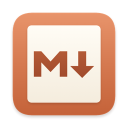
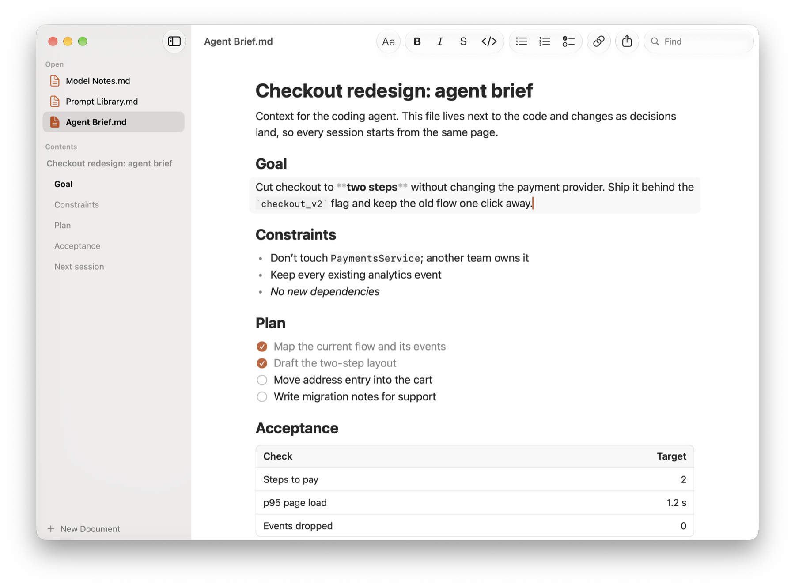

<p align="center">
  
</p>

<h1 align="center">MDown</h1>

<p align="center">
  Read Markdown. Edit when you need to.<br>
  Free, open source, and native Swift.
</p>

<p align="center">
  <a href="https://mdown.sandeepgangarapu.com">Website</a> ·
  <a href="https://github.com/sandeepgangarapu/mdown/releases/latest/download/MDown.dmg">Download for Mac</a>
</p>



We use Markdown more than ever, because AI speaks it. Plans, prompts, notes, and the answers that come back are all Markdown now. Most of the time I'm just reading them. Sometimes I fix a line or two.

Every app I tried had that backwards. They took forever to open a file, then opened it in edit mode, full of symbols. Some weren't free. Markdown wasn't really why they existed, so they came with accounts, sync, and vaults.

So I made MDown the other way around. It opens a Markdown file instantly, as a clean page. When you want to change something, click it, and the Markdown behind that block appears. Click away, and it's a page again.

MDown isn't trying to be the most powerful Markdown editor. It's trying to be the nicest place to read Markdown.

## What it does

- Opens Markdown instantly, as a clean page.
- Click any block to edit the Markdown behind it. Press Escape or click away to read.
- Return, Tab, and the arrow keys do what you'd expect: new paragraphs, nested lists, the next block.
- Lists your open files, the current file's headings, the files in its folder, and recent files in the sidebar. Click a file to read it in the same window, or go up a folder to look around. Choose which sections show in Settings.
- Uses shortcuts you already know: ⌘B, ⌘K, and ⌘F, plus ⇧⌘T, ⇧⌘H, ⇧⌘B, and ⇧⌘L for title, heading, body, and checklist, the same as Notes.
- Works with plain `.md` files. No account, sync, or vault. Git, your terminal, and your AI tools read the same file you do.
- Keeps your words on your Mac. Only update checks and linked images go online.

That's it.

## Install

1. [Download MDown.dmg](https://github.com/sandeepgangarapu/mdown/releases/latest/download/MDown.dmg).
2. Open it and drag MDown to Applications.
3. Open MDown from Applications.

Or install it with [Homebrew](https://brew.sh):

```sh
brew trust sandeepgangarapu/tap && brew install --cask sandeepgangarapu/tap/mdown
```

MDown needs macOS 26 or later and runs natively on Apple silicon and Intel. It checks for new versions and updates itself.

MDown isn't notarized, so macOS asks you to confirm it once. Open System Settings, go to Privacy & Security, and click **Open Anyway** next to MDown. The [first launch guide](https://mdown.sandeepgangarapu.com/#first-launch) shows each step.

## It's yours too

MDown is free and open source. Read the code, change what you don't like, and send your fixes back. If something is broken or missing, [open an issue](https://github.com/sandeepgangarapu/mdown/issues).

### Build from source

You need Xcode 26 or later.

```sh
git clone https://github.com/sandeepgangarapu/mdown.git
cd mdown
open MDown.xcodeproj
```

Choose the MDown scheme and run it.

Run the tests for the Markdown engine and editing rules:

```sh
swift test --package-path MDownCore
```

Build the DMG (needs `pip install dmgbuild`):

```sh
Packaging/make-dmg.sh
```

### Make a release

Prepare a Sparkle-signed release and add its entry to the top of the appcast, without publishing:

```sh
Packaging/release.sh 1.1.0 "Release notes (Markdown or HTML)"
```

This increments the build number and updates the project version. From a clean checkout, `Packaging/release.sh --publish 1.1.0 "Notes"` also commits, rebases, pushes, and creates the GitHub release. Run either preparation or publication for a version, not both.

- The EdDSA key must be at `~/.config/mdown/sparkle_ed25519_private.key`.
- Install `cmark` (`brew install cmark`) for Markdown and HTML release notes.
- Review the DMG, the project version, and `docs/appcast.xml` before publishing. The asset name stays `MDown.dmg`.
- Build intermediates stay in temporary storage. Set `DERIVED_DATA_PATH`, `DMG_OUTPUT`, or `DMGBUILD` to use a scratch folder or a venv's `dmgbuild`.
- No Developer ID or notarization is required. Packaging checks the app's nested signatures again inside the finished DMG, Sparkle's ad-hoc helper signatures are kept, and update archives are verified separately with EdDSA.

### Project layout

| Folder | What's in it |
| --- | --- |
| `MDown/` | The Mac app: SwiftUI views, the inline block editor, sidebar, toolbar, and menus |
| `MDownCore/` | A Swift package with the Markdown model, formatting actions, editing rules, and their tests |
| `Packaging/` | The DMG layout and background |
| `docs/` | The website at [mdown.sandeepgangarapu.com](https://mdown.sandeepgangarapu.com) |

MDown parses Markdown with Apple's [swift-markdown](https://github.com/swiftlang/swift-markdown).

## License

MDown is available under the [MIT License](LICENSE).
